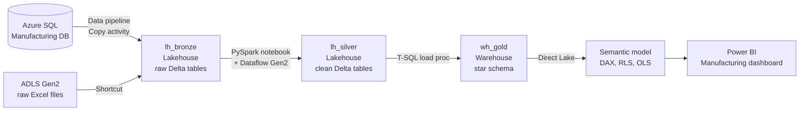

# Fabric Manufacturing Lab

An end-to-end **Microsoft Fabric** project built on anonymised manufacturing data
(factories, parts, 201k inventory transactions, quality NCRs and waste),
as hands-on preparation for the **DP-600: Fabric Analytics Engineer** exam.

> The source data is fully anonymised (names and codes replaced). Only scripts and
> explanations are stored here: no data files, passwords or connection strings.

## Architecture

## Stages

| # | Folder | What is built | DP-600 skills |
|---|---|---|---|
| 1 | [01-ingest](01-ingest/) | Workspace, `lh_bronze` lakehouse, ADLS shortcut, pipeline copy from Azure SQL | Shortcuts, pipelines, choosing a copy method, mirroring |
| 2 | [02-silver-notebook](02-silver-notebook/) | PySpark cleaning to Delta, InvTraHis partitioned by month, Dataflow Gen2 | Notebooks, dataflows, partitioning, OPTIMIZE / V-Order |
| 3 | [03-gold-warehouse](03-gold-warehouse/) | `wh_gold` star schema, SCD Type 2 on Parts, Factory-WorkCentre bridge, views, load procedure, scheduled pipeline | Warehouse T-SQL, star schema, SCD, bridge tables, orchestration |
| 4 | [04-semantic-model](04-semantic-model/) | Direct Lake model, measures, calculation group, field parameter, RLS by factory, OLS on cost columns, dashboard | Semantic models, DAX, security |
| 5 | [05-manage](05-manage/) | XMLA tools (SSMS, DAX Studio, Tabular Editor), Git integration, deployment pipeline, lineage, roles, sensitivity label, KQL | Plan, implement and manage a solution |

## Data

| Table | Rows | Description |
|---|---|---|
| Factory | 9 | Factories |
| Parts | 2,532 | Finished and intermediate SKUs with cost breakdown |
| PartRunRates | 2,553 | Crew and line speed per SKU |
| InvTraHis | 201,102 | Inventory transactions (stock in / out) |
| Quality | 253 | Non-conformance reports (NCRs) |
| Waste | 18,849 | Waste and give-away per shop order |

## Status

- [ ] Stage 1: Land the data
- [ ] Stage 2: Silver
- [ ] Stage 3: Gold
- [ ] Stage 4: Semantic model + dashboard
- [ ] Stage 5: Manage

## Author

Jose Paul Irimpan. Built with Claude (Anthropic) as a tutor; every step was run and checked by me.
